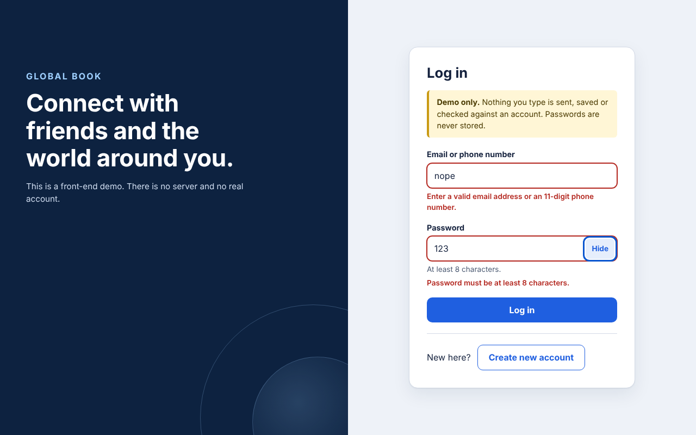
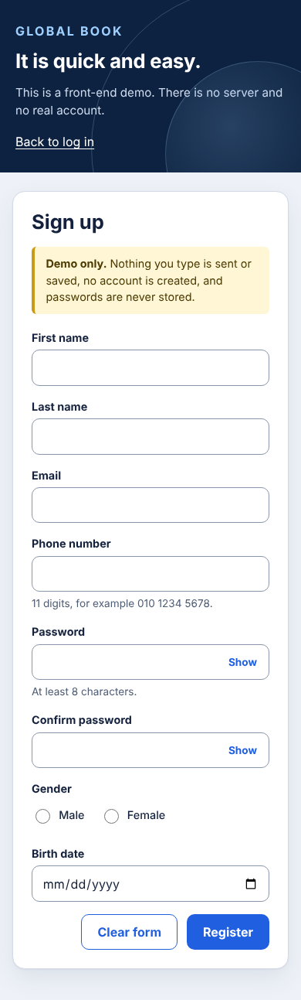

# Global Book: sign-in and sign-up demo

Two front-end pages, a log-in form and a sign-up form, built with plain HTML, CSS and JavaScript. No build step, no dependencies, no CDN.

Live demo: https://simple-countries-flages-k12l.vercel.app





## This is a demo, not real authentication

- There is no server, no database and no account system.
- Passwords are only read to validate them (length, and a match on the confirmation field). They are **never stored**: nothing is written to `localStorage`, `sessionStorage` or cookies, nothing is sent over the network, and nothing is put in the URL.
- A form that passes validation just opens `pages/welcome.html`, which says clearly that nothing happened on a server. Every page also shows a "Demo only" notice.
- Password inputs have no `name` attribute, so even without JavaScript the browser would not submit them.

I checked the original code: it did not store anything either. It only validated, and its form action pointed at a placeholder page. This version keeps that behaviour and makes it explicit.

## What you get

- Real validation messages next to each field, shown on blur and while typing once a field has been visited, and for all fields on submit (focus moves to the first invalid field).
- Show/hide password buttons with an accurate accessible name.
- Proper `<label>`s, `fieldset`/`legend` for the gender choice, `aria-describedby`, `aria-invalid`, `autocomplete` tokens.
- Responsive split layout (brand panel plus form), visible focus rings, `prefers-reduced-motion` respected.

Validation rules (see `js/validate.js`):

- Email: simple `name@domain.tld` shape. The original regex rejected top-level domains longer than 3 letters, this one does not.
- Phone: 11 digits, optionally grouped 3-4-4 (same shape as the original).
- Names: letters from any script, spaces, apostrophes, dots, hyphens. No digits.
- Password: at least 8 characters (the original accepted 7), confirmation must match.
- Birth date: a real date, not in the future, 1900 or later.

## Changes from the original

- "glopal book" is now "Global Book", and other typos in the UI text are fixed.
- The "forgetting password" and "create a page" links did nothing (empty `href`), so they were removed.
- `pages/test.html` ("this is test page for action attribute") became `pages/welcome.html`. `pages/test.html` is kept as a redirect so the old path still works.

## Run it

```sh
python3 -m http.server 5265
# open http://localhost:5265
```

## Tests

The validation rules are pure functions and are unit tested with the Node built-in test runner (no packages):

```sh
node --test tests/validate.test.js
```

## Verification

- `node --test tests/validate.test.js`: 9 tests passed (Node 22).
- Headless Chromium (Playwright) at 1280x800 and 390x844: empty and invalid submissions show the right messages and focus the first invalid field, show/hide toggle works, valid forms reach `welcome.html`, `localStorage`, `sessionStorage` and cookies were empty afterwards, `test.html` redirects, no console errors, no horizontal scroll on mobile. I did not run a screen reader.

## Known limitations

- Demo only, by design. There is no way to actually log in or register.
- Gender is a two-option field, as in the original.
- The live demo URL listed for this repo was copied from the repo's homepage setting.

## Notes

UI and code quality improvements were made with AI assistance (Claude, Anthropic), reviewed and verified by building and running the app.
